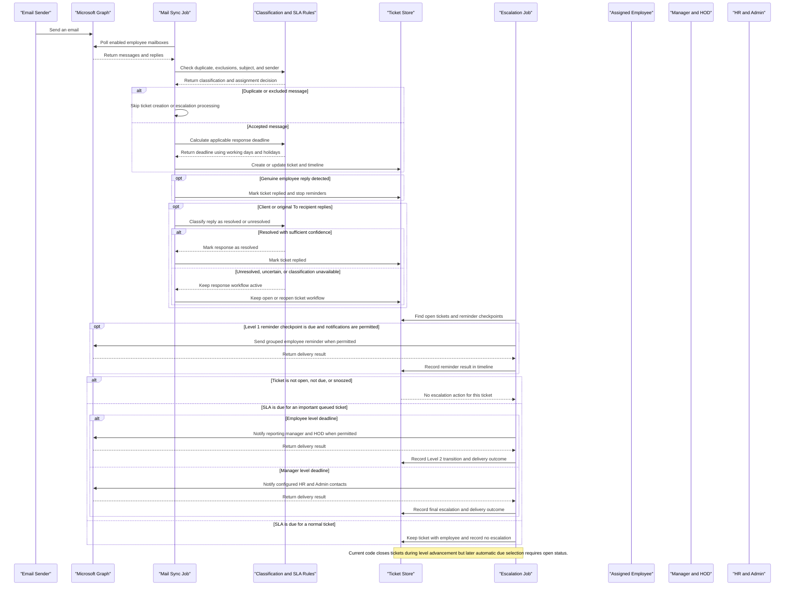

# Core Business Workflows

The Escalation Tracker helps teams turn monitored email conversations into assigned work, follow response deadlines, and notify the appropriate people when important requests remain unresolved. Employees and administrators can review ticket status and history, while scheduled jobs synchronize mail, manage reminders and escalations, and produce reports.

## Domain Entities

| Entity | Service / Bounded Context | Description | Key Relationships |
|---|---|---|---|
| Ticket | Email Response Tracking | A monitored email conversation being worked and tracked through its response lifecycle. | Belongs to a department; may be assigned to an employee; has timeline events and escalation records. |
| User | Workforce and Access | An employee or administrator who uses the tracker or receives assigned work and notifications. | Belongs to a department; may report to primary and secondary managers; may own a monitored mailbox. |
| Department | Organizational Routing | A business unit used to scope tickets, configure SLA rules, and identify its HOD. | Has users, tickets, an HOD, and department-specific escalation contacts and settings. |
| Keyword Category | Work Classification | A configured subject keyword grouping that marks a ticket as important and eligible for escalation. | Classifies tickets into customer/project, PPC/internal, escalation-trigger, or normal work. |
| Working Hours and Holiday | SLA Calendar | The work calendar used to calculate response deadlines while excluding non-working days and holidays. | Shared by SLA and reminder deadline calculations for tickets. |
| Escalation Contact | Final Escalation Routing | An HR or Admin contact eligible to receive a final escalation for one or more departments. | May apply to a specific department or all departments; receives Level 3 escalation records. |
| Timeline Event | Ticket Audit | A human-readable record of ticket receipt, reply, reminders, status changes, and escalation activity. | Belongs to a ticket; may be recorded by a user or by a scheduled process. |
| Escalation Record | Escalation Audit | A record of a Level 3 notification attempt and its delivery result. | Links a ticket to an escalation contact. |
| Weekly Report Delivery | Reporting | A delivery attempt for a weekly department or organization-wide workbook. | Identifies the reporting period, recipient, report scope, and delivery outcome. |

## Service-to-Domain Mapping

The application is a single PHP application with scheduled PHP jobs, a shared MySQL database, and integrations with Microsoft Graph and Gemini. The components below are logical bounded contexts, not independently deployed microservices.

| Service | Domain Context | Owned Entities | External Dependencies |
|---|---|---|---|
| Mail Sync Job (`cron/fetch_new_mails.php`) | Email Intake and Response Tracking | Ticket, Timeline Event | Microsoft Graph for monitored mailboxes; Gemini for selected mail and client-reply classification |
| Escalation Job (`cron/check_escalations.php`) | SLA and Escalation Management | Ticket, Timeline Event, Escalation Record | Microsoft Graph for notification delivery and original mail lookup |
| Shared PHP Helpers (`includes/functions.php`, `includes/keyword_helper.php`) | Classification and SLA Rules | Keyword Category, Working Hours, Holiday | Shared MySQL data |
| Authenticated Web Pages (`public/`) | Ticket Operations and Administration | Ticket, User, Department, Timeline Event, Escalation Contact | Shared MySQL data; Microsoft Graph when loading original email |
| Assistant Chat and Action Assistant (`public/assistant_chat.php`, `public/admin_assistant.php`) | Help and Confirmed Admin Actions | Pending action in session; confirmed changes to Ticket and Timeline Event | Gemini for general help; Microsoft Graph for supported reminder and alert actions |
| Weekly Report Job (`cron/send_weekly_reports.php`) | Reporting | Weekly Report Delivery and report views of ticket activity | Microsoft Graph for workbook delivery |

The shared MySQL database is the source of truth for tickets, assignments, workflow state, access roles, department routing, and audit history. Microsoft Graph is the source for mailbox messages and email delivery; the tracker stores ticket metadata and retrieves original message content from Graph when needed. Gemini classifies selected mail and supports chat responses; it does not authorize or execute ticket actions.

## Primary Workflows

### Workflow 1: Monitored Email to Ticket

1. The scheduled mail-sync job polls only active users whose mailbox monitoring is enabled.
2. For each message, the job looks for an existing ticket by message/conversation identifiers and then by a normalized sender/subject match. Duplicate messages do not create another ticket.
3. Excluded subjects and ignored automated senders are filtered from the escalation workflow.
4. For a new message, configured subject keywords determine its category and escalation eligibility. Configured keywords take priority over AI classification. If no keyword matches, AI may classify the subject and body preview; a high-confidence non-actionable result remains normal work.
5. The ticket is assigned to an active employee matching the sender address when possible; otherwise it is assigned to the monitored mailbox owner.
6. The job calculates an SLA deadline, creates an open ticket, and records receipt and classification context in the timeline. The message body is not stored in the ticket record.

**Business decisions:** A ticket can be tracked as normal work without being eligible for manager/HR escalation. Only important tickets queued by classification advance through the automatic escalation levels.

### Workflow 2: Replies, Reminders, and Automatic Escalation

1. Mail sync checks later messages in monitored mailboxes against tracked conversations.
2. Auto-replies do not count as genuine employee or client responses.
3. A genuine reply from the assigned mailbox owner marks the ticket replied. A later client reply, or a reply from an address in the original To list, is classified for resolution; CC-only replies are not treated as tracked To-recipient replies.
4. A client reply classified as resolved with confidence of at least 0.80 marks the ticket replied. An unresolved, uncertain, or unavailable classification keeps the reminder workflow active; if the ticket was closed, the workflow is reopened and its stage clock is restarted.
5. The escalation job checks eligible open tickets. At a due reminder checkpoint, it groups pending reminders by recipient and sends a digest when delivery is possible. A failed delivery remains eligible for retry.
6. At an SLA deadline, normal/unimportant tickets remain with the employee. Eligible important tickets advance to the next escalation level: Level 2 routes to the reporting manager(s) and HOD when manager notifications are enabled; Level 3 routes to configured HR/Admin contacts.
7. The system records reminders, escalation attempts, and delivery outcomes in ticket timeline and escalation history.

**Current implementation note:** The escalation job currently changes a ticket to `closed` when it advances to Level 2 or Level 3, while its subsequent automatic due-ticket query selects only `open` tickets. Therefore, the code does not automatically select a Level 2 ticket for the next scheduled escalation unless another workflow reopens it. This differs from a simple continuously open Level 1 → Level 2 → Level 3 process and should be considered when operating or changing the escalation rules.

### Workflow 3: Admin-Requested Ticket Action

1. An Admin or Super Admin requests one supported action for an explicit ticket: pause permitted notification triggers, send the assigned employee a reminder, or alert configured HR/Admin contacts.
2. The application checks the role, department access, ticket status, recipient availability, and relevant recipient snapshot.
3. It stages a preview; no email is sent and no ticket setting is changed at this point.
4. The administrator reviews the ticket and recipient details and explicitly confirms. On confirmation, the application rechecks access and current state before executing.
5. The result is recorded in the ticket timeline. A manual HR/Admin alert does not advance or reset the automatic escalation stage.

Regular users can receive help and workflow guidance but cannot initiate these admin-only actions.

### Workflow 4: Reports

The web application can produce a date-specific ticket CSV scoped to the signed-in user's permitted tickets. A scheduled weekly job builds department-scoped or organization-wide workbooks for configured recipients, records delivery attempts, and allows failed deliveries to be retried without resending successful recipient/period deliveries.

## Cross-Service Data Flows

- **Mailbox intake:** Microsoft Graph supplies messages from enabled employee mailboxes. The mail-sync job matches messages to conversations, applies keyword and AI classification, and writes ticket metadata and timeline events to MySQL.
- **Reply resolution:** Mail sync obtains message metadata and, when needed, reply text from Graph. Client-reply text may be sent to Gemini for satisfaction classification. The outcome updates the ticket state and audit trail in MySQL. Message bodies are not stored as ticket fields.
- **SLA and escalation:** The escalation job reads ticket state, department/user hierarchy, keyword eligibility, working hours, holidays, and escalation contacts from MySQL. It fetches original mail context from Graph when constructing escalation notifications, sends grouped email through Graph, and records delivery outcomes in MySQL.
- **User operations:** Authenticated PHP pages read and update tickets and configuration in the same MySQL database. Ticket visibility is limited by role and department; Admin and Super Admin actions use additional role checks.
- **AI Help:** The floating help chat sends a curated application guide and recent chat turns to Gemini. It does not provide Gemini with live ticket rows or database access. Supported ticket actions are prepared for a human preview and confirmation in the application.
- **Reporting:** The weekly report job composes report data from ticket activity and organizational routing in MySQL, then delivers generated workbooks through Graph. Successful and failed delivery attempts are tracked in MySQL.

There are no internal service-to-service APIs or event bus in the current design; the PHP web application and cron jobs communicate through the shared database.

## Business Workflow Sequence

<!-- mermaid-checked: every participant uses `participant Id as "Label"`, no \n in aliases/messages/notes, every alt/opt/loop closed by end, no `:` inside any alias -->

## Business Rules & Decision Logic

- **Mailbox eligibility:** Only active users with mailbox monitoring enabled are polled. The mailbox owner's department and identity provide the default ticket routing.
- **Duplicate prevention:** Message and conversation identifiers are checked first; normalized sender/subject matching is used as a fallback.
- **Classification:** Subject keyword matches take precedence over AI. Keyword categories prioritize escalation triggers, customer/project work, and PPC/internal work. Ignored automated senders and excluded subjects do not enter the escalation path. A configured urgent subject rule can classify work as an escalation trigger.
- **Escalation eligibility:** `is_important` and `escalation_queued` must both be true for automatic Level 2/3 progression. Tickets without that eligibility remain assigned to the employee after an SLA breach.
- **Reply handling:** Employee auto-replies are not genuine replies. Client auto-replies do not stop or restart reminders. Client resolution requires an AI satisfaction result with confidence at least 0.80; unresolved or uncertain results keep the workflow active. Replies from original To recipients can be considered; CC recipients are intentionally excluded.
- **SLA calculation:** The shared work-hours calculator excludes configured non-working days and holidays. Current code uses a 24-working-hour SLA for external senders, a 2-hour SLA for Design/PPC, and the department's configured `sla_settings.response_hours` for other internal senders (the schema seeds departments with 48 hours). The current reminder query selects Level 1 tickets; its checkpoints are 12 working hours for external senders, 1 hour for Design/PPC, and 1.5 hours for other internal senders. These current implementation values differ from the simplified timing description in parts of the README and comments.
- **Escalation routing:** Level 2 uses the assignee's reporting managers and department HOD unless manager notifications are paused. Level 3 uses configured HR/Admin escalation contacts for the department or organization. Some sender-specific routing exceptions are implemented in the escalation job.
- **Snooze and notification controls:** Snoozed tickets are excluded until the snooze time. Admins can pause employee notifications; Super Admins can also pause manager/HOD notifications. These controls do not themselves resolve a ticket.
- **Manual action safety:** Admin-only actions require an explicit ticket, department authorization, valid current state, and a separate preview-and-confirm step. Recipient or assignee changes after preview invalidate the relevant confirmation snapshot.
- **Audit and retention:** Ticket activity is appended to the timeline, and Level 3 delivery attempts are recorded separately. The escalation job deletes closed tickets after ten days; related timeline and escalation records are removed by database cascade.
- **Authorization:** Regular users are scoped to their department; Admins are restricted to their department for ticket actions; Super Admin has organization-wide access. Administrative actions are revalidated at execution time.
- **Reporting delivery:** Department managers and HODs receive scoped department reports; configured HR/Admin contacts can receive the full weekly workbook. Successful deliveries are tracked to prevent duplicates, while failures remain retryable.
